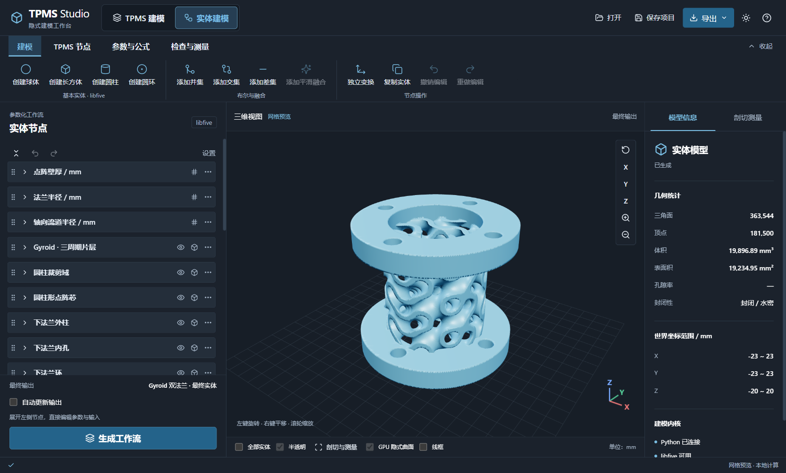
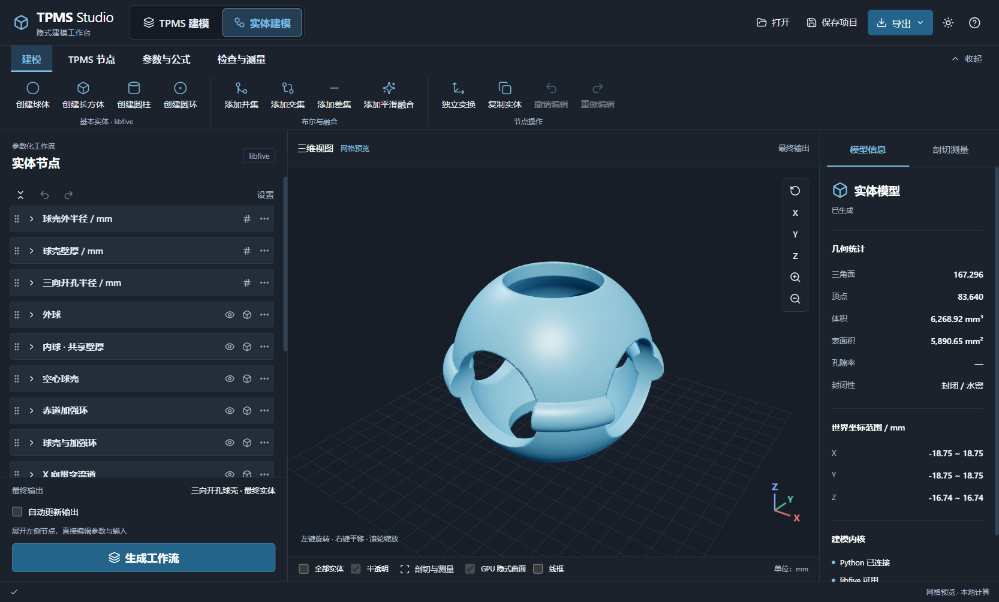
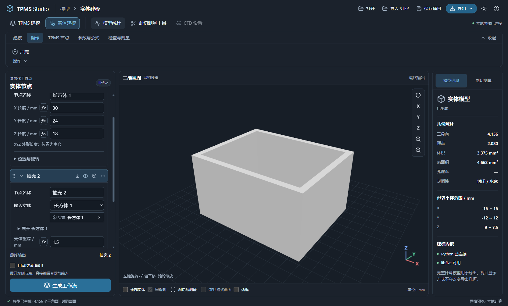
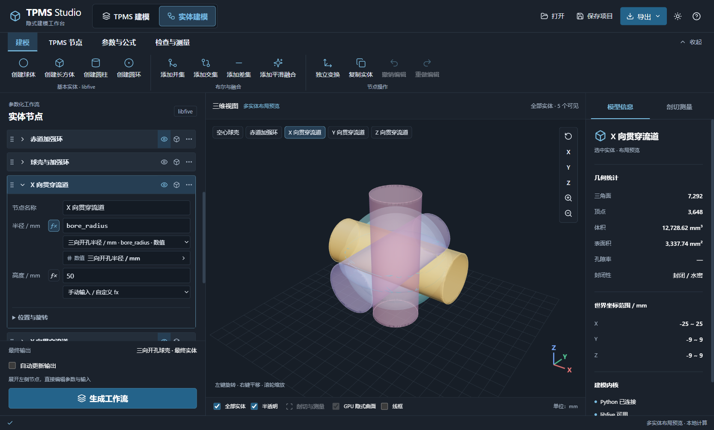
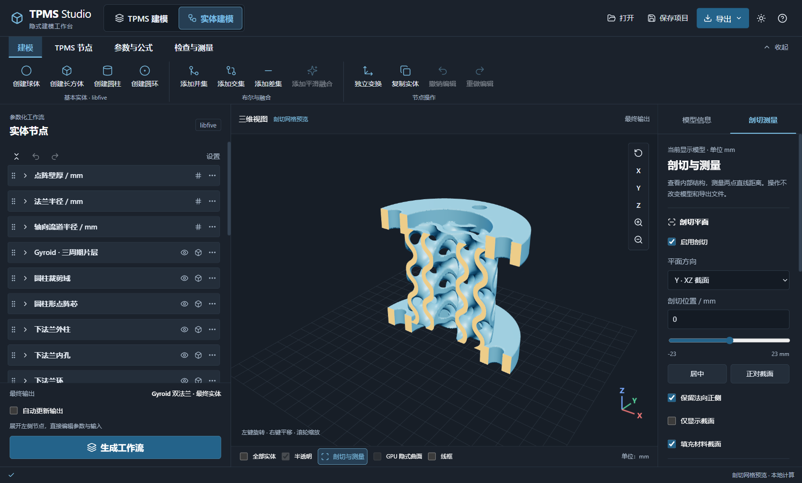
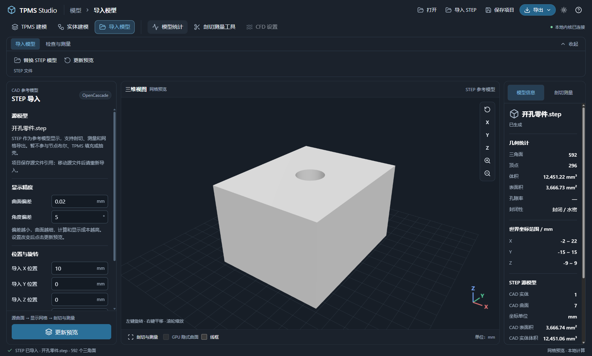
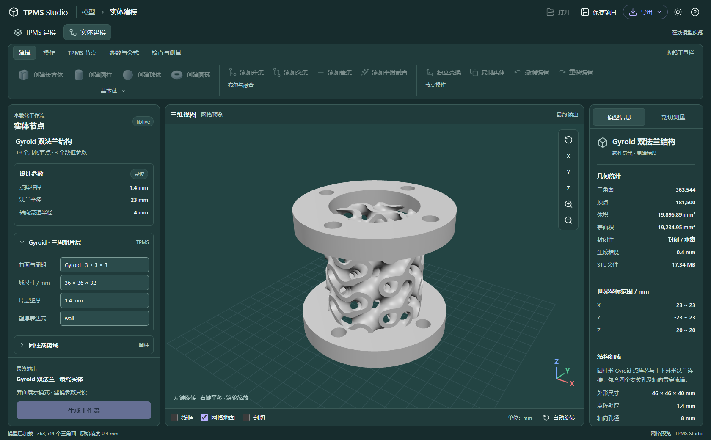
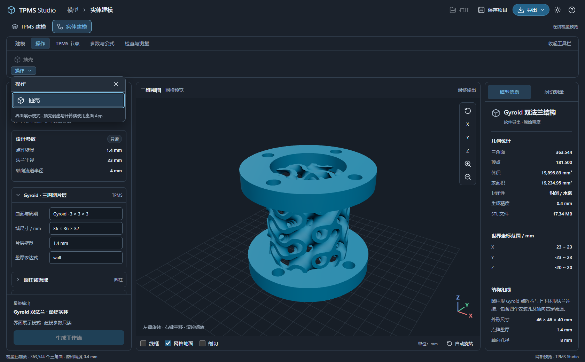

# TPMS Studio

**以数学函数定义结构，以节点组织建模过程。**

TPMS Studio 是用于 TPMS 多孔结构、隐式实体和参数化组合建模的桌面软件。它将曲面参数、基本实体、数学公式、布尔运算、三维检查和网格导出放在同一个工程工作台中；普通 TPMS 还可以生成用于流体仿真的带边界分组体网格。



[快速开始](#快速开始) · [复杂模型画廊](docs/model-gallery.md) · [节点建模](docs/node-modeling.md) · [版本更新](CHANGELOG.md) · [开发记录](DEVELOPMENT_LOG.md)

## 建模示例

下面均为软件实际生成、显示和导出的模型。示例保留可编辑 JSON 项目，包含参数、上游引用及最终输出，打开后可以修改并重新生成。

### Gyroid 双法兰结构

用圆柱裁剪三周期 Gyroid，将点阵芯与两个环形法兰合并，再减去四个安装孔和轴向贯穿流道。19 个几何节点与 3 个数值参数展示 TPMS、基本体、交集、并集、差集及共享变换的组合。

[打开示例项目](examples/showcase/gyroid-flanged-core.json) · [节点关系与参数说明](docs/model-gallery.md#gyroid-双法兰结构)

### 三向开孔球壳与加强环

外球减去内球得到空心壳，加入赤道圆环，再减去 X/Y/Z 三条正交流道。11 个几何节点与 3 个参数展示参数壁厚、加强实体及多方向开孔。



[打开示例项目](examples/showcase/perforated-ring-sphere.json) · [建模说明](docs/model-gallery.md#三向开孔球壳与加强环)

示例用于介绍建模方法，未进行承载、流动、制造或打印验收。网格尺寸是提取尺度，实际几何细节需要结合模型检查与精度收敛判断。

## 核心能力

| 能力 | 当前支持 |
| --- | --- |
| TPMS 结构设计 | Gyroid、Diamond、Primitive、I-WP、Neovius；片层与实体模式、三轴尺寸与周期、壁厚、等值面偏移 |
| 孔隙率与梯度 | 目标孔隙率反求壁厚或偏移；片层沿 X/Y/Z 线性梯度壁厚；管状卷绕 |
| 隐式实体 | 球、长方体、圆柱、圆环、TPMS 与自定义空间公式；平移和旋转 |
| 组合建模 | 并集、交集、差集、基本实体平滑融合，以及引用上游的独立变换 |
| 抽壳操作 | 解析距离函数基本体向内抽壳；参数壁厚、封闭内腔或六个轴向开口 |
| 参数化工作流 | 数值、公式、向量节点；共享尺寸与位置参数、上游引用、类型和循环检查 |
| 卡片交互 | 空白创建、搜索节点、节点内编辑、拖动排序、拖动引用、共享嵌套编辑、撤销重做 |
| 多实体预览 | 同时查看各节点、稳定配色、选中高亮、半透明、逐个显隐与相对位置判断 |
| 三维检查 | XYZ 方向标、轴向视角、线框、任意法向剖切、材料截面、两点距离与几何统计 |
| STEP 导入 | STEP / STP 实体及曲面参考预览；显示精度、平移旋转、剖切测量、网格导出与源文件引用项目 |
| 表面导出 | STL / OBJ / PLY；原始、分级简化、自定义目标面数；可编辑 JSON 项目 |
| CFD 网格 | 普通 TPMS 的流体域提取、入口/出口/壁面分组、四面体与棱柱边界层、局部加密 |
| 质量诊断 | 缩放雅可比统计与直方图、低质量单元定位、VTU 质量场导出 |

普通 TPMS 可用连续场 Marching Cubes 或可选 libfive 自适应提取；实体节点工作流使用 libfive。Electron + React 提供界面，Three.js/WebGL2 处理预览，独立 Python 进程负责计算。原 Qt 界面保留为兼容入口。

## 工程工作台

顶部在 **TPMS 建模 / 实体建模** 之间切换。功能选项卡按当前工作区显示：TPMS 侧集中曲面与仿真；实体侧提供建模、操作、TPMS 节点、参数与公式。两个工作区均提供检查与测量，工具栏可收起。

“操作”选项卡提供**抽壳**：先创建并选中解析距离函数基本体，再添加抽壳节点，设置向内壁厚和开口方向。支持参数引用、保存恢复和表面网格导出；布尔运算集中在“建模”。抽壳后可用基本体与差集开孔，或通过并集增加加强结构。复杂组合、TPMS 和距离近似基本体暂不支持自动等壁厚抽壳。详细步骤见 [抽壳建模](docs/solid-modeling.md#抽壳操作)。



[可编辑开口盒壳示例](examples/operations/shell-demo.json)：从长方体基本体创建壳体，打开后可调整壁厚、开口和输出网格尺寸。

| 区域 | 作用 |
| --- | --- |
| 顶部 | 切换工作区、创建节点、打开/保存项目、导出质量与文件、明暗主题 |
| 左侧 | TPMS 参数，或实体/参数卡片；节点内编辑，上游引用与输出设置 |
| 中央 | 模型与多实体预览，旋转、平移、缩放、XYZ 方向标与视角控制 |
| 右侧 | 当前模型统计、世界坐标范围、剖切测量与建模内核状态 |
| 底部 | 生成、自动更新、查看选项、进度与计算反馈 |

### 同时查看实体与布尔输入

“全部实体”默认显示各有效几何节点。可以隐藏无关中间结果，只保留球壳、加强环和三条流道，通过半透明观察它们的相对位置。单击模型、视口标签或卡片即可选中；卡片眼睛逐个控制显隐。



布局中的重叠实体仍是独立网格。点击“生成工作流”显示指定最终输出，并集、差集等运算结果才成为可导出的最终模型；查看开关、透明度和显隐不会替换导出快照。修改参数后须重新生成输出，再导出新结果。

### 查看内部截面

生成最终实体后打开“剖切与测量”，选择轴向或自定义法向，移动切面查看材料与孔道。橙色填充代表被切开的材料，孔洞保持空白，右侧显示截面面积、轮廓与包围盒信息。



剖切和测量只改变查看状态，导出仍保留完整实体。两点测量给出直线距离和 XYZ 差值，精度取决于显示网格；它不是自动壁厚或孔径分析。[剖切与测量指南](docs/inspection.md)

## STEP 参考模型导入

顶部点击“导入 STEP”选择 `.step` / `.stp` 文件，读取后进入独立的“导入模型”工作区。左侧设置曲面偏差、角度偏差、位置与旋转，点击“更新预览”后可剖切测量或导出 STL / OBJ / PLY。



此功能需要可选 OpenCascade Python 依赖：

```sh
python -m pip install -r requirements-step.txt
```

项目保存源文件引用、摘要和导入设置，需要同时保留 STEP 文件。模型按源文件单位转换到 mm；当前为参考导入，不参与隐式节点布尔、TPMS 填充、抽壳或 CFD。详见 [STEP 导入指南](docs/step-import.md)。

## 快速开始

### 安装与运行

当前提供源码运行，需要 Python、Node.js **22.12+**（建议 24 LTS）；尚未提供包含运行时的独立安装包。

```powershell
git clone --branch 新增建模功能 https://github.com/Starlre/TPMS-Studio.git
cd TPMS-Studio
python -m venv .venv
.\.venv\Scripts\Activate.ps1
python -m pip install -r requirements.txt
python launch_desktop.py
```

启动器首次安装界面依赖并构建，首次安装需要网络。Windows 也可双击 `run_tpms.bat` 或 `启动Electron.cmd`；旧 Qt 界面使用 `python app.py` 或 `run_qt.bat`。

**要运行实体建模与画廊项目，需先配置 libfive 原生库。** TPMS 连续场建模可在没有 libfive 时运行。安装、官方源码版本和许可见 [libfive 指南](docs/libfive.md)。

### 第一个 TPMS

1. 在“TPMS 建模”选择曲面，设置尺寸与周期。
2. 在“结构”选择片层或实体，设置壁厚或偏移；需要时启用目标孔隙率。
3. 设置生成精度，点击“生成模型”。
4. 检查模型、统计与截面，在顶部“导出”保存表面模型。

### 第一个节点项目

1. 在“实体建模”点击“＋新节点”，创建基本体或 TPMS。
   也可点击顶部“基本体”下拉卡片，选择长方体、立方体、圆角方盒、圆柱、圆角圆柱、胶囊体、球体、圆锥、圆台、椭球体或圆环。
2. 编辑尺寸、位置和旋转，在“全部实体”下判断相对位置。
3. 创建布尔节点，设置输入 A/B；差集为 **A 减 B**。
4. 在节点菜单“设为输出”，在“设置”指定最终网格尺寸。
5. 点击“生成工作流”，保存 JSON 项目或导出表面网格。

也可以在顶部“打开”直接载入画廊 JSON。打开项目恢复参数与引用，随后生成输出；加载示例前请保存已有工作。

## 自定义公式

空间公式使用以模型中心为原点的毫米坐标 `x/y/z`，支持三角函数、`sqrt/abs/exp/log`、四则运算、幂及 `min/max`。公式与节点尺寸表达式是两种输入：空间公式描述外形，`radius * 2` 等参数表达式驱动尺寸。

在“自定义公式 → 实体结构”，偏移为 0 时保留 **`f(x,y,z) >= 0`** 的区域。例如：

```text
球体：10 - sqrt(x*x + y*y + z*z)
椭球：1 - (x/13)**2 - (y/3.2)**2 - (z/6.3)**2
两个正内场的并集：max(fA, fB)
两个正内场的交集：min(fA, fB)
两个正内场的差集：min(fA, -fB)
```

最后三行是数学关系说明，实际输入时需将 `fA/fB` 替换成具体表达式。片层模式则在函数零等值面的两侧构造壁厚。计算内核转换后的材料标量采用负值在实体内部，不能直接与公式输入的符号混用；完整说明见 [模型画廊](docs/model-gallery.md#公式的符号约定)。公式由受限 AST 解析，不执行任意 Python 代码。

## 导出与仿真

| 输出 | 用途 |
| --- | --- |
| JSON 项目 | 保存参数、实体、引用关系、输出和精度，可继续编辑 |
| STL / OBJ / PLY | 三角表面模型，用于切片、打印与后续网格处理 |
| BDF / MSH | 普通 TPMS 流体体网格；BDF 可作为 COMSOL 网格导入来源 |
| 边界 JSON / 质量 VTU | 边界与网格统计、完整缩放雅可比质量场 |

表面导出可选原始精度、高质量约 70%、标准约 40%、轻量约 20% 或目标面数。简化面数是近似目标；薄壁、细孔和仿真用途应检查特征与水密性。当前统计对应生成快照，简化后的实际结果以导出反馈和回读文件为准。

普通 TPMS 在“CFD 网格”设置流向、单元尺寸、流体表面采样、边界层、局部加密及曲率自适应。生成后可查看仿真区域和质量报告，再导出 COMSOL 体网格。编号为入口 **101**、出口 **102**、壁面 **103**、流体域 **201**，负方向端面为入口；导入时长度按 mm 解释。

实体组合暂不支持 CFD 网格。体网格文件不包含 COMSOL 材料、物理场、边界条件或求解器，格式回读已验证，COMSOL 实际导入尚待验收。完整设置与流程见 [CFD 网格指南](docs/cfd-meshing.md)。

## 文档导航

| 文档 | 内容 |
| --- | --- |
| [模型画廊](docs/model-gallery.md) | 复杂示例、可编辑项目、参数与节点关系、实际网格验证 |
| [节点建模](docs/node-modeling.md) | 创建、拖动排序与引用、参数共享、布局预览与最终输出 |
| [实体建模](docs/solid-modeling.md) | 基本体、坐标变换、布尔与融合 |
| [剖切与测量](docs/inspection.md) | 任意截面、材料填充、包围盒和两点距离 |
| [CFD 网格](docs/cfd-meshing.md) | 流体域、网格设置、边界分组、质量与 COMSOL 输出 |
| [libfive 内核](docs/libfive.md) | 原生库安装、精度约定、支持范围与许可 |
| [Electron 工程说明](docs/electron.md) | 运行、架构、通信、资源管理与验证 |
| [更新日志](CHANGELOG.md) / [开发记录](DEVELOPMENT_LOG.md) | 用户功能变化、需求时间与验收记录 |

## 范围与限制

- 输出为三角表面或体网格，支持 STEP 参考导入；当前不导出 STEP / Parasolid / 精确 B-Rep。
- 节点界面是可拖动的纵向 Notebook 卡片，尚无自由连线画布、Voronoi 或体网格节点。
- 含 TPMS 的上游不参与平滑融合；管状卷绕不进入 libfive 实体工作流。
- 多实体显隐和透明度属于查看状态，暂不随 JSON 保存；布局模式不提供重叠实体聚合截面或体积。
- GPU 隐式预览与网格底图混合显示，仅用于受支持的普通 TPMS；实体组合和自定义公式显示网格。
- 精度、周期数量和网格细化增加内存与计算开销；未发布与商业软件对比的性能基准。

## 在线预览

[](https://starlre.github.io/TPMS-Studio/)

打开 [在线工作台](https://starlre.github.io/TPMS-Studio/) 查看 Gyroid 双法兰结构。界面沿用桌面软件的暗色工具栏、左侧节点卡片、三维视口与右侧模型检查器；支持旋转缩放、XYZ 视角、暗亮主题、线框、任意法向剖切、截面统计和两点测量，并可下载原始 STL 与可编辑项目。

网页保留“TPMS 建模 / 实体建模”切换、按模块显示的功能选项卡、实体创建/布尔/抽壳/节点/参数分组及文件导出菜单，可用于展示桌面 App 界面。建模工具明确禁用、参数只读；工作区切换不改变预置模型。

“基本体”下拉卡片与桌面共用 11 种形体目录，“操作”选项卡及下拉仅展示抽壳。支持展开浏览与键盘关闭；实际建模计算在桌面 App 中完成。



网页展示软件实际导出的预置模型，参数与节点为只读说明；修改与重新生成使用桌面软件。详见 [在线预览指南](docs/online-viewer.md)。

## 开发验证

```powershell
python -m pytest -q
cd desktop
npm ci
npm run build
npm test
npm run verify-notebook-cards
npm run verify-multi-entity
```

更多真实窗口验收与画廊截图命令见 [Electron 工程说明](docs/electron.md#验证与截图)。
