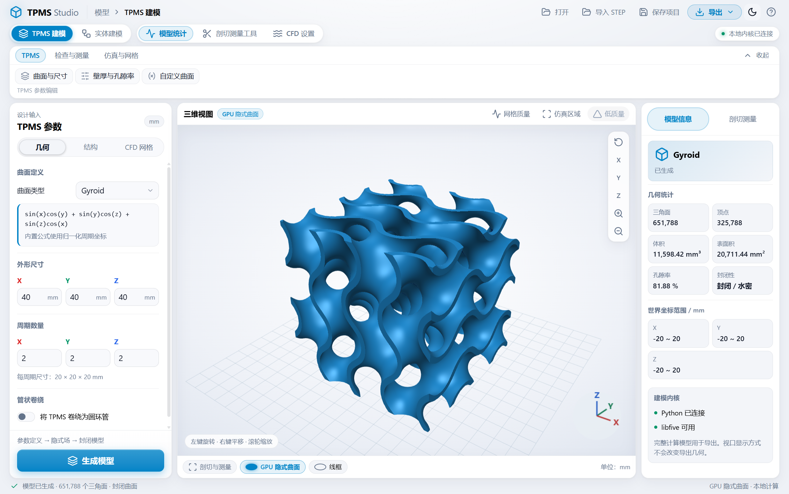
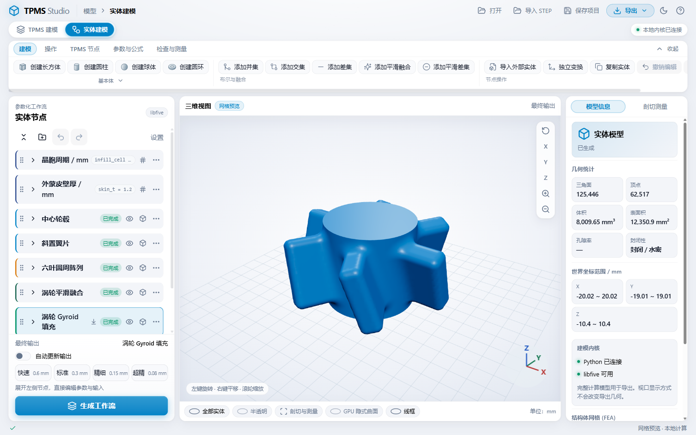
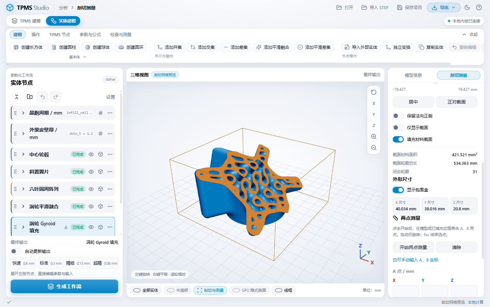
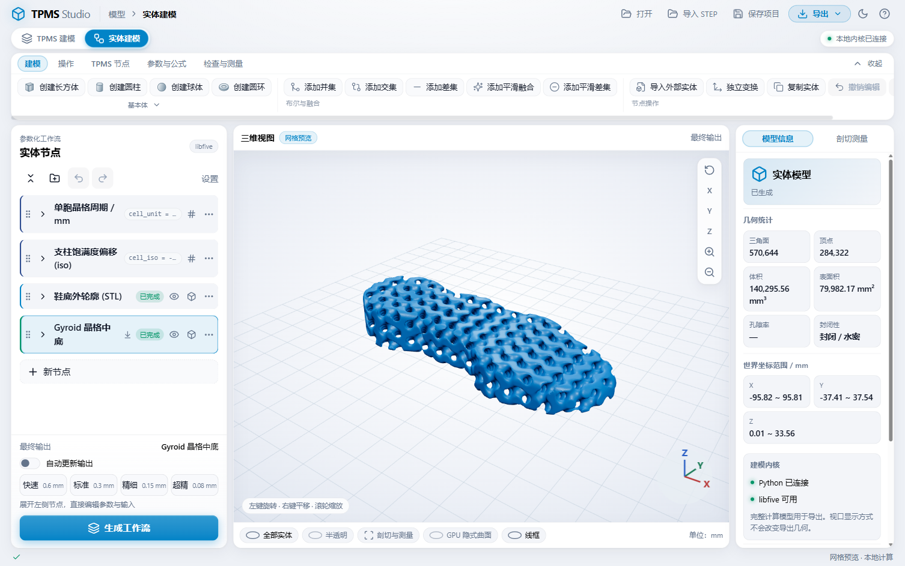
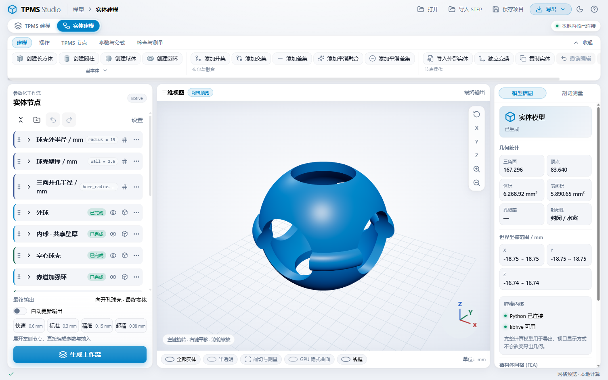
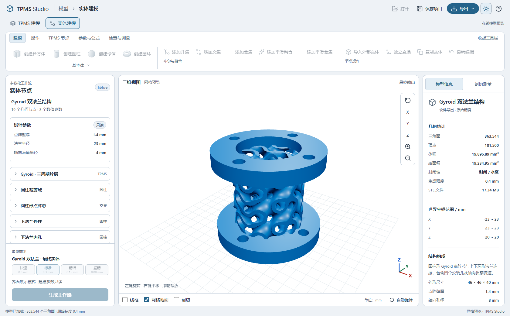

# TPMS Studio

**以数学函数定义结构，以节点组织建模过程。**

TPMS Studio 是一款本地工程桌面软件（Electron + React + Three.js + Python / `libfive`），专注于 **TPMS 三周期极小曲面**、**隐式实体与特征建模**、**外部 CAD/网格共形填充**、**三维剖切测量**以及 **3D 打印 / FEA / CFD 网格导出**。



[快速开始](#快速开始) · [在线 3D 预览](https://starlre.github.io/TPMS-Studio/) · [模型画廊](docs/model-gallery.md) · [节点建模](docs/node-modeling.md) · [剖切与测量](docs/inspection.md) · [更新日志](CHANGELOG.md)

---

## 核心亮点与建模示例

> 以下截图均来自当前版本浅灰白（`light`）默认工作台实机生成与渲染。

### 1. 六叶圆周阵列平滑涡轮 + 一键 Gyroid 填充与中心斜切

使用`圆柱`中心轮毂与`圆角方盒`斜置翼片做**六叶圆周阵列**并**平滑融合**，再通过**一键 `TPMS 填充`**生成带平滑接壁外蒙皮的内部 Gyroid 晶格；在`剖切与测量`中围绕模型中心旋转 **`32°`** 斜切，直观查看内部多孔流道、材料截面面积与包围盒尺寸。





[打开示例项目](examples/showcase/radial-turbine-infill.json)

### 2. 外部 STL / STEP 实体直接参与隐式建模（跑鞋中底点阵）

导入封闭 `.step / .stp / .stl / .obj / .ply` 外部模型作为**外部实体 (`imported_solid`)**，仅需 **2 个几何节点**即可直接完成贴地对齐与共形 Gyroid 点阵填充。



[打开示例项目](examples/showcase/stl-shoe-midsole.json)

### 3. 多节点参数化布尔组合（三向开孔球壳与加强环）

外球与内球差集得到空心壳，融合赤道加强环并减去三向正交流道；通过**数值 / 公式 / 向量**节点共享参数，支持实时拖动排序、上游引用与多实体布局查看。



[打开示例项目](examples/showcase/perforated-ring-sphere.json) · [更多画廊示例](docs/model-gallery.md)

---

## 能力总览

| 模块 | 支持能力 |
| --- | --- |
| **TPMS 曲面** | `Gyroid` / `Diamond` / `Primitive` / `I-WP` / `Neovius`（片层与实体模式）；三轴尺寸与周期、壁厚/等值面偏移、目标孔隙率反求、XYZ 线性梯度壁厚、管状卷绕、自定义空间公式 |
| **隐式实体与操作** | 11 种解析基本体（长方体、立方体、圆角方盒、圆柱、圆角圆柱、胶囊体、球体、圆锥、圆台、椭球体、圆环）；并集/交集/差集/平滑融合/平滑差集；抽壳（向内/向外/对称与六面开口）、偏置、镜像、线性阵列、圆周阵列、一键 `TPMS 填充` |
| **外部模型接入** | 封闭 `.step / .stp / .stl / .obj / .ply` 转为隐式场直接参与布尔与填充；另支持独立 STEP 参考工作区 |
| **工作台与视图** | 默认浅灰白主题（支持一键切换暗色）；4 档精度预设（`快速 0.6` / `标准 0.3` / `精细 0.15` / `超精 0.08 mm`）；高分屏 DPR 2.0 渲染、GPU 隐式光线步进、多实体半透明布局 |
| **剖切与测量** | X / Y / Z / 自定义法向剖切、**围绕模型中心任意角度旋转（`±180°`）**、材料填充与面积/轮廓统计、三列包围盒尺寸、三维两点直线测量 |
| **网格与仿真导出** | `STL / OBJ / PLY`（原始与分级简化）；**FEA 四面体网格**（HXT 并行 + Netgen 优化 + 缩放雅可比质量诊断）；**CFD 流体域网格**（入口/出口/壁面分组与边界层）；支持 `.bdf` / `.msh`（已通过 COMSOL 6.3 实机导入验收）与 `_quality.vtu` |

---

## 快速开始

需要 **Python 3.10+** 与 **Node.js 22.12+**（实体节点工作流需配置 `libfive` 原生库，详见 [libfive 指南](docs/libfive.md)；STEP 导入需可选 `requirements-step.txt`）。

```powershell
git clone https://github.com/Starlre/TPMS-Studio.git
cd TPMS-Studio
python -m venv .venv
.\.venv\Scripts\Activate.ps1
python -m pip install -r requirements.txt
python launch_desktop.py
```

Windows 也可直接双击 `run_tpms.bat` 或 `启动Electron.cmd` 启动桌面工作台。

---

## 在线 3D 预览（GitHub Pages）

[](https://starlre.github.io/TPMS-Studio/)

打开 [在线工作台](https://starlre.github.io/TPMS-Studio/) 可在浏览器中直接交互查看 Gyroid 双法兰结构（支持旋转缩放、亮/暗主题切换、线框、任意法向剖切、两点测量与原始 STL / 项目 JSON 下载；建模编辑与计算请在桌面软件中完成）。

---

## 文档导航

- [模型画廊](docs/model-gallery.md) · [节点建模](docs/node-modeling.md) · [实体建模](docs/solid-modeling.md)
- [剖切与测量](docs/inspection.md) · [CFD 网格](docs/cfd-meshing.md) · [libfive 内核](docs/libfive.md)
- [Electron 工程说明](docs/electron.md) · [更新日志](CHANGELOG.md) · [开发记录](DEVELOPMENT_LOG.md)

## 开发与验证

```powershell
python -m pytest -q
cd desktop
npm ci
npm run build
npm test
```
