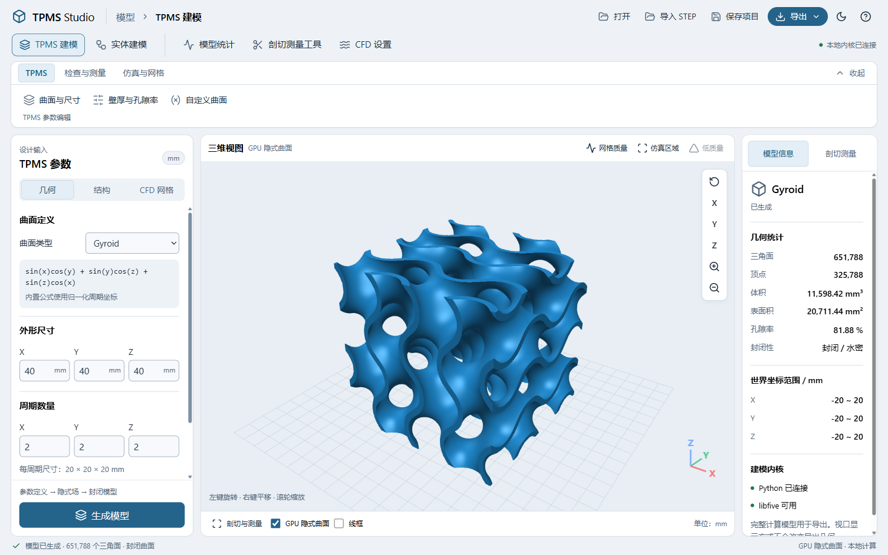
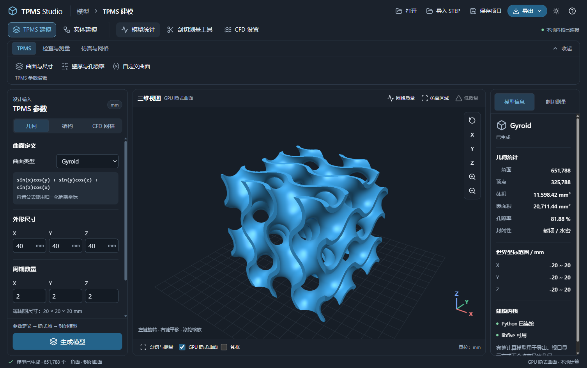
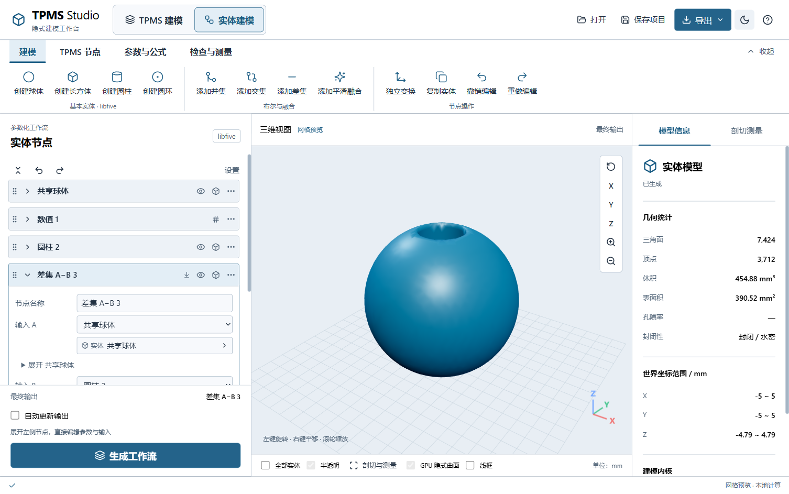

# Magpie 青绿色 App 界面设计指南

> 配色更新：当前软件已按新参考图切换为深灰蓝色，圆角、布局、字号和交互保持本指南约定。当前颜色请使用 [深灰蓝配色](blue-gray-palette.md)；本文保留青绿版本的配色经验，公共界面截图展示当前版本。

> 用途：在以后开发的 App 中复现 TPMS Studio 当前界面的视觉和交互。
>
> 基准：2026-10-14 的 Electron 桌面版，顶部导航、浅青色面板、紫色操作按钮。
> 来源：用户提供的 Magpie 截图与 TPMS Studio 的实际实现。这是本项目整理的设计约定，不是 Magpie 官方设计规范。

## 1. 先确定要复现的几个特征

这套界面的辨识度来自浅青色的大面积背景、略亮的内容面板、克制的紫色强调和清晰的分区。背景、卡片、输入框保持同一色系，主要通过亮度、边框与间距区分层级。正文使用深色，用户长时间阅读参数和数据时仍能看清。

本项目最终采用顶部导航：第一行放品牌、当前位置和文件操作；第二行切换工作区及分析工具；下方是当前工作区的功能工具栏。主体保留给参数、预览和结果，没有额外的左侧导航栏。

可以记住这五条约定：

1. 浅青色形成整体环境，紫色集中用于主操作和键盘焦点。
2. 功能导航放在顶部，中央优先展示模型、图表、图片或正在编辑的内容。
3. 面板用 12px 圆角与细边框，控件用 6–9px 圆角。
4. 参数排列紧凑，但标签和输入数值保持可读。
5. 明暗主题、选中、禁用、计算中和错误状态都使用统一规则。



## 2. 布局：从工作流程分区

```text
┌──────────────────────────────────────────────────────────┐
│ 品牌 / 当前位置                 打开 保存 导出 主题 帮助 │ 56px
├──────────────────────────────────────────────────────────┤
│ 工作区切换          分析快捷入口               内核状态   │ 48px
├──────────────────────────────────────────────────────────┤
│ 功能选项卡                                               │
│ 当前类别的操作按钮；可收起                                │ 自动高度
├─────────────────┬───────────────────────┬────────────────┤
│ 输入参数        │                       │ 信息 / 检查工具│
│ 独立滚动        │      主内容区域       │ 独立滚动       │ 剩余高度
│                 │                       │                │
│ 固定主操作按钮  │      查看选项         │                │
├─────────────────┴───────────────────────┴────────────────┤
│ 进度 / 操作结果                                  运行状态│ 32px
└──────────────────────────────────────────────────────────┘
```

顶栏的全局操作保持固定位置。工作区切换回答“现在做什么”，功能工具栏回答“当前有哪些命令”，参数页签回答“编辑哪组设置”。三者职责清楚，切换功能工具栏时不修改业务数据。

当前桌面版的具体尺寸如下。数值单位均为 CSS px；系统缩放后，截图中的物理像素会不同。

| 部位 | 当前值 | 作用 |
| --- | --- | --- |
| 文件栏 / 工作区行 / 状态栏 | 56 / 48 / 32 | 形成稳定的全局框架 |
| 主体左右外边距 | 18 | 内容与窗口边缘分开 |
| 三个面板之间 | 12 | 用留白建立清晰分区 |
| 普通参数 / 主体 / 信息栏 | 310 / 自动伸缩 / 230 | 优先保留中央预览面积 |
| 节点编辑 / 主体 / 信息栏 | 360 / 自动伸缩 / 230 | 复杂输入需要更宽的编辑区 |
| 剖切测量信息栏 | 290 | 容纳坐标输入和测量操作 |
| 面板内容水平内边距 | 14 | 紧凑而不贴边 |
| 面板圆角 | 12 | 大容器统一轮廓 |

主体用 `minmax(0, 1fr)` 或明确的最小宽度伸缩，滚动区域必须设置 `min-height: 0`。生成按钮位于参数面板底部，参数列表自行滚动；页面本身不整体上下滚动。弹出菜单要显示在面板之上，不能被容器的 `overflow` 裁掉。

这些宽度适合本项目的工程工作台。以后做笔记、图片编辑或数据管理 App，可以换成两栏或单栏；顶部层级、色值、圆角和控件规则继续沿用。

## 3. 配色：按用途命名，不按颜色命名

先建立语义变量，再让组件引用变量。以后换主题时，只修改变量映射，不逐个修改按钮、卡片和输入框。

下表来自当前 `desktop/src/native.css`。

| CSS 变量 | 用途 | 亮色 | 暗色 |
| --- | --- | --- | --- |
| `--page` | 整体背景 | `#bedbd8` | `#172c2d` |
| `--panel` | 内容面板 | `#c9e4df` | `#203b3b` |
| `--raised` | 分段控件底色、卡片标题 | `#c0dcd7` | `#294848` |
| `--input` | 输入框、次操作底色 | `#dbefea` | `#2b4b4b` |
| `--viewport` | 模型 / 画布背景 | `#cce6e1` | `#234443` |
| `--text` | 主文字 | `#203535` | `#eef7f4` |
| `--muted` | 辅助文字、普通图标 | `#4b6564` | `#b4cdca` |
| `--border` | 输入框、菜单边界 | `#72938b` | `#7b9b96` |
| `--divider` | 面板边框、分隔线 | `#aacdc5` | `#395956` |
| `--selected` | 选中背景 | `#d5ece6` | `#304f4e` |
| `--accent` | 强调文字、焦点 | `#5245c4` | `#b9b0ff` |
| `--accent-fill` | 主按钮背景 | `#5b4cd4` | `#b9b0ff` |
| `--accent-hover` | 主按钮悬停 | `#4c3fba` | `#cec6ff` |
| `--on-accent` | 主按钮文字 | `#ffffff` | `#242044` |
| `--success` | 成功、连接状态 | `#237849` | `#7fd5a3` |
| `--danger` | 错误、危险操作 | `#a52822` | `#ffb4ab` |

背景和面板采用实色。当前效果不依赖透明模糊、渐变或 Mica；这样在 Electron 中更容易稳定复现，也减少渲染成本。面板阴影很轻：亮色为 `0 1px 2px #21463b0a`，暗色为 `0 1px 2px #05161518`。浮层需要更强的阴影，以区分覆盖关系。

紫色主按钮每个任务区只突出一个，例如生成、应用或确认。打开、保存等普通命令采用图标加文字的轻量按钮；导出采用紫色文字、细描边和胶囊轮廓。成功和错误仍分别使用绿色和红色，并附带明确文字。

模型、数据系列、入口出口和测量点保留业务语义颜色。界面强调色不能替代所有科学数据颜色。

当前普通单模型采用亮天蓝底色、柔和高光与淡蓝轮廓光；亮色主题使用稍深的蓝色。材质与灯光的最新取值见 [当前配色](blue-gray-palette.md)，由桌面和网页共用配置。高光应随曲面与观察方向变化，并保留暗部层次，避免亮斑掩盖薄壁与孔洞。多实体区分色、CFD 边界和质量诊断色仍按业务含义显示。

### 对比度检查的经验

按 sRGB 色值计算，亮色正文对面板约为 9.65:1，亮色主按钮文字约为 6.12:1；暗色正文约为 11.00:1，暗色主按钮约为 7.85:1。主文字和主操作对比度较充足。

当前亮色辅助文字 `#4b6564` 在整体背景 `#bedbd8` 上约为 4.28:1，低于普通文字常用的 4.5:1 目标；输入边框 `#72938b` 对输入底色约为 2.80:1。如果新 App 要严格满足相应无障碍要求，应进一步加深辅助文字和必要的控件边界，再逐对测量。可以从辅助文字 `#425a59`、输入边框 `#66887f` 开始校准。这是后续复用建议，当前软件配色未因此修改。



## 4. 字体与密度

使用系统字体：`'Segoe UI', 'Microsoft YaHei UI', 'Microsoft YaHei', sans-serif`。页面基准 16px，行高 1.5。中文说明不用字间距装饰，数值采用等宽数字；公式和代码可使用 Consolas 等等宽字体。

| 内容 | 当前规格 |
| --- | --- |
| 品牌 | 19px，主要文字 600 字重 |
| 面板标题 | 18px，600 字重 |
| 分组标题 / 工作区按钮 | 15px |
| 参数标签 / 工具按钮 | 14px |
| 输入数值 / 主按钮文字 | 16px |
| 提示与统计标签 | 12–13px，长说明行高约 1.6 |

密集参数通过减少空白、标签与值同行、相关输入并排实现。普通参数行的标签列约 104px，值列占剩余宽度；XYZ 并排，公式、长文本和错误说明单独占行。重复单位靠近输入值，必要时固定在输入框右侧，并预留文字空间。

这组字号是桌面基准。大屏或面向需要更大文字的用户时，优先增加辅助文字和参数标签字号，再检查面板宽度、换行和滚动，避免压缩数值输入区。

## 5. 控件的统一规则

| 控件 | 尺寸与样式 | 交互 |
| --- | --- | --- |
| 输入框 / 下拉框 | 高度至少 36px，圆角 6px | 始终有标签；焦点显示紫色轮廓 |
| 工作区按钮 | 高度至少 38px，圆角 9px | 选中使用更浅底色、边框和状态属性 |
| 普通工具按钮 | 高度约 34px，圆角 7px | 图标加文字；悬停仅改变颜色 |
| 图标按钮 | 36 × 36px，圆角 8px | 提供名称和悬停提示 |
| 主按钮 | 高度至少 42px，圆角 8px | 一个明确动作；计算中显示进度并禁用重复提交 |
| 分段页签 | 外层圆角 8px、选中项圆角 6px | 用于互斥的几何、结构或信息视图 |
| 菜单 / 对话框 | 圆角 12px、独立阴影 | 键盘可操作，Esc 可关闭 |
| 节点卡片 | 圆角 8px、细边框 | 展开后原位编辑，保留选中与引用关系 |

图标沿用同一套 Lucide 线性 SVG，常用大小 18–20px；不要混入 emoji 或位图图标。图标配文字时作为装饰隐藏于辅助技术；独立图标按钮提供 `aria-label`。复选框保留标准交互，强调色与主题一致。

禁用按钮同时设置 `disabled` 和较低透明度。焦点轮廓不能为了视觉简洁被去掉。工作区按钮使用 `aria-pressed`；真正的选项卡使用 `tablist`、`tab` 和 `aria-selected`，并实现方向键、Home、End 导航。



## 6. 交互经验：让布局稳定

悬停、选中和按下主要改变背景、文字或边框。按钮预留 1px 边框，不在悬停时增加尺寸，也不使用缩放或位移使相邻控件跳动。当前颜色过渡约 140ms，减少动态效果设置下关闭过渡。

计算任务放到独立进程或工作线程。主界面显示计算状态，生成按钮防止重复提交，取消入口保持可见；3D 视图仍允许观察。参数变化后明确显示“待更新”，导出使用成功生成的快照。界面状态和业务状态要分清：切换标签、展开节点或改变查看方式，不应意外修改模型。

长列表各自滚动，生成操作固定可见。节点编辑只展开当前需要的参数，上游输入按需展开；拖动操作同时提供按钮或菜单替代。小窗口仍保留生成、查看和关闭菜单的入口。

如果 App 包含 Canvas、WebGL 或原生绘图区，也要同步主题背景。仅修改 HTML 背景不能改变 Three.js 的 `scene.background`。主题切换时同时更新画布背景、网格和标记，保留模型和相机状态，避免重建渲染器。

## 7. 可复用的 CSS 骨架

下面是独立的起步骨架，覆盖本风格的色值、容器、输入和按钮；业务组件、图标和菜单逻辑由新项目补充。复制时保留变量名称，按用途引用。

```css
:root {
  color-scheme: light;
  --page: #bedbd8; --panel: #c9e4df; --raised: #c0dcd7;
  --input: #dbefea; --viewport: #cce6e1;
  --text: #203535; --muted: #4b6564;
  --border: #72938b; --divider: #aacdc5; --selected: #d5ece6;
  --accent: #5245c4; --accent-fill: #5b4cd4;
  --accent-hover: #4c3fba; --on-accent: #fff;
  --success: #237849; --danger: #a52822;
  --panel-shadow: 0 1px 2px #21463b0a;
  font: 16px/1.5 'Segoe UI', 'Microsoft YaHei UI',
    'Microsoft YaHei', sans-serif;
}
:root[data-theme="dark"] {
  color-scheme: dark;
  --page: #172c2d; --panel: #203b3b; --raised: #294848;
  --input: #2b4b4b; --viewport: #234443;
  --text: #eef7f4; --muted: #b4cdca;
  --border: #7b9b96; --divider: #395956; --selected: #304f4e;
  --accent: #b9b0ff; --accent-fill: #b9b0ff;
  --accent-hover: #cec6ff; --on-accent: #242044;
  --success: #7fd5a3; --danger: #ffb4ab;
  --panel-shadow: 0 1px 2px #05161518;
}
* { box-sizing: border-box; }
body { margin: 0; background: var(--page); color: var(--text); }
button, input, select, textarea { font: inherit; }
.app-shell {
  height: 100dvh;
  display: grid;
  grid-template-columns: minmax(0, 1fr);
  grid-template-rows: 56px 48px auto minmax(0, 1fr) 32px;
}
.app-header, .workspace-navigation {
  display: flex; align-items: center; gap: 12px;
  padding: 0 20px; min-width: 0;
}
.file-actions { display: flex; gap: 5px; margin-left: auto; }
.ribbon { margin: 0 18px 12px; padding: 12px; }
.workspace {
  display: grid; min-height: 0; margin: 0 18px; gap: 12px;
  grid-template-columns: 310px minmax(260px, 1fr) 230px;
}
.panel, .ribbon {
  min-width: 0; min-height: 0;
  background: var(--panel); border: 1px solid var(--divider);
  border-radius: 12px; box-shadow: var(--panel-shadow);
}
.panel { display: flex; flex-direction: column; overflow: hidden; }
.panel-heading { padding: 16px 14px 12px; font-size: 18px; }
.panel-scroll { flex: 1; min-height: 0; overflow: auto; padding: 0 14px 14px; }
.panel-footer { padding: 10px 14px 14px; border-top: 1px solid var(--divider); }
.field {
  display: grid; grid-template-columns: 104px minmax(0, 1fr);
  align-items: center; gap: 8px; margin: 8px 0; font-size: 14px;
}
input, select, textarea {
  width: 100%; min-width: 0; min-height: 36px;
  border: 1px solid var(--border); border-radius: 6px;
  background: var(--input); color: var(--text); padding: 5px 9px;
}
input[type="number"] { font-size: 16px; font-variant-numeric: tabular-nums; }
input[type="checkbox"] { width: 17px; min-height: 17px; accent-color: var(--accent-fill); }
button {
  display: inline-flex; align-items: center; justify-content: center; gap: 8px;
  min-height: 34px; padding: 5px 9px; border: 1px solid transparent;
  border-radius: 7px; color: var(--text); background: transparent; cursor: pointer;
  transition: background 140ms, border-color 140ms, color 140ms;
}
button:hover { background: var(--raised); }
button[aria-pressed="true"] { background: var(--selected); border-color: var(--divider); }
button:disabled { opacity: .5; cursor: not-allowed; }
.primary { min-height: 42px; border-radius: 8px; background: var(--accent-fill); color: var(--on-accent); }
.primary:hover { background: var(--accent-hover); }
:focus-visible { outline: 2px solid var(--accent); outline-offset: 2px; }
.canvas-area { flex: 1; min-height: 0; background: var(--viewport); }
.statusbar { display: flex; align-items: center; padding: 0 20px; color: var(--muted); font-size: 12px; }
@media (max-width: 1150px) {
  .workspace { margin: 0 12px; gap: 8px; grid-template-columns: 290px minmax(240px, 1fr) 240px; }
  .ribbon { margin-left: 12px; margin-right: 12px; }
}
@media (prefers-reduced-motion: reduce) { button { transition: none; } }
```

HTML / JSX 按五个区域顺序组织即可。`.workspace` 内通常是参数 `.panel`、中央 `.panel` 和信息 `.panel`；`.panel-scroll` 与 `.panel-footer` 是同级元素，才能保证底部操作固定。

Electron 保留系统窗口边框即可。主进程使用实际主题对应的 `backgroundColor` 减少加载时闪白；通过受限 preload / IPC 调用后端计算，不把界面样式与 Python 业务实现绑在一起。新项目可采用其他桌面外壳，视觉规范仍可复用。

## 8. 小窗口、手机和其他 App 的适配

当前软件默认窗口为 1520 × 980，最小窗口为 1100 × 720，已验证 1120 × 760 下的主要操作。1150px 以下缩小外边距和面板宽度，不把整套文字一起缩小。工具命令过多时，在工具栏内部滚动或放入“更多”菜单。

如果要做手机 App，以下是迁移建议，当前 TPMS Studio 尚未实现手机布局：

- 保留配色、字体层级和圆角，主体改为单栏。
- 参数与信息变成抽屉、页签或独立页面，避免把桌面三栏压进手机。
- 精简顶部导航为少数主要任务，次要操作放入菜单。
- 按移动平台要求扩大触摸区域，通常至少 44–48 的逻辑尺寸。
- 为底部系统手势区域预留安全距离，输入键盘出现时保证确认按钮可达。

## 9. 复现顺序

1. 明确 App 的主要内容与任务，再画顶部和主体分区。
2. 建立明暗色值和字号变量；先完成亮色，再单独校准暗色。
3. 完成一个参数面板、一组导航和一个主按钮，确认整体比例。
4. 将同一规则扩展到列表、卡片、菜单和对话框。
5. 同步绘图区背景，保留业务颜色与数据含义。
6. 补齐焦点、禁用、进度、取消、错误和保存状态。
7. 在实际运行窗口中截取亮色、暗色、窄窗口和复杂内容截图。

发现界面仍不像参考时，优先检查布局位置、背景 / 面板关系、圆角和按钮权重。单独换配色，或单独更换桌面框架，都不足以复现这套效果。

## 10. 可直接交给开发工具的提示词

```text
请按《Magpie 青绿色 App 界面设计指南》设计或改造这个 App。

先阅读现有源码，保留业务功能、数据格式与现有技术架构。
采用顶部导航，不增加左侧分组导航：第一行品牌、当前位置、全局操作；
第二行工作区和快捷工具；下方为按当前任务显示的功能工具栏。
主体优先展示正在处理的内容，参数与信息按需要使用两栏或三栏。

亮色：背景 #bedbd8，面板 #c9e4df，输入 #dbefea，
正文 #203535，选中 #d5ece6，主按钮 #5b4cd4，按钮文字 #fff。
暗色：背景 #172c2d，面板 #203b3b，输入 #2b4b4b，
正文 #eef7f4，选中 #304f4e，主按钮 #b9b0ff，按钮文字 #242044。
使用语义 CSS 变量，必要时校准辅助文字和控件边界的对比度。

面板圆角 12px，控件圆角 6–9px，面板间距 12px，
主体左右留白 18px，内容内边距 14px。
系统字体，基准 16px；输入数值 16px，参数标签 14px，标题 18px。
参数紧凑排列，相关值并排，主要操作固定在操作区底部。
使用统一 Lucide SVG 图标，提供明确标签与键盘焦点。
轻量颜色过渡，不通过位移或缩放改变按钮的布局位置。

同步 Canvas / WebGL / 原生绘图区主题，保留业务语义颜色。
实现明暗主题、禁用、计算进度、取消、错误和待保存状态。
先实现，再用真实运行窗口检查亮色、暗色、小窗口和复杂内容，
给出实际截图与验证结果。
```

## 11. 验收时看什么

| 方面 | 验收重点 |
| --- | --- |
| 风格 | 浅青背景和圆角面板形成统一环境，紫色强调集中 |
| 导航 | 工作区位于顶部；全局命令与参数分组层级明确 |
| 可读性 | 字体可读，长标签不遮挡数值；正文与边界按角色校验对比度 |
| 状态 | 选中、焦点、禁用、计算、错误都有明确反馈 |
| 稳定性 | 悬停和切换不使控件跳动，长内容不会覆盖固定操作 |
| 主题 | 面板、菜单、对话框和绘图区一起切换 |
| 操作 | 键盘可到达功能，拖动有替代操作，弹窗可关闭 |
| 尺寸 | 实际小窗口无整体横向溢出，主操作仍可见 |

## 12. 当前项目中的参考入口

- [主题与布局 CSS](../desktop/src/native.css)：本指南色值和尺寸的主要来源。
- [React 工作台](../desktop/src/main.jsx)：顶部导航、表单、状态与文件操作。
- [Three.js 视口](../desktop/src/Viewport.jsx)：绘图区主题与查看交互。
- [当前界面说明](native-ui.md)：面向软件用户的操作概览。

迁移文档到其他目录时，请同时复制三张截图并保持相对位置：`electron-tpms-light.png`、`electron-tpms-dark.png`、`electron-notebook-cards-light.png`。以上源码链接用于当前项目，新项目可替换成自己的实现位置。
