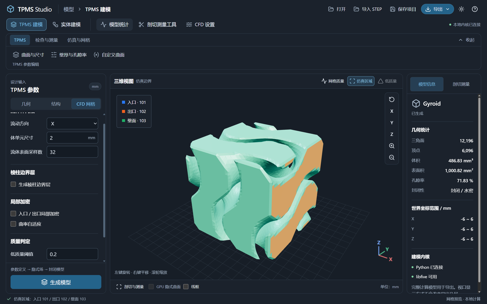
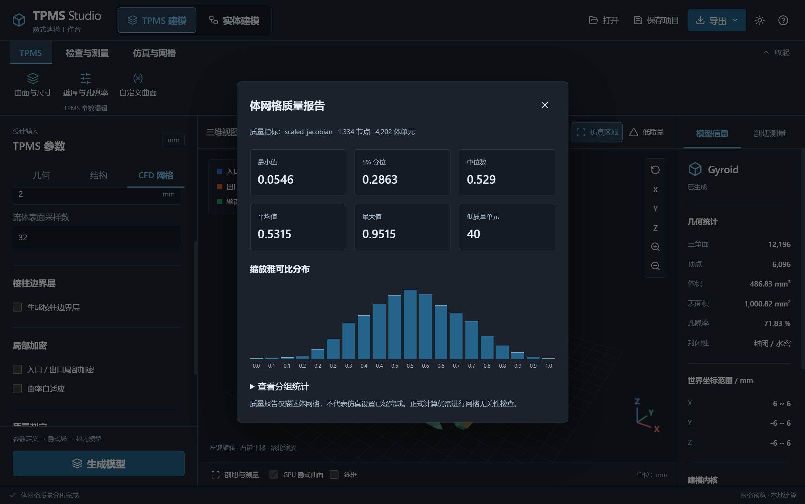

# CFD 流体网格与 COMSOL 导出

本功能针对普通 TPMS 工作区的孔隙流体域。流体域是外形包围盒内的材料补集；片层结构可能形成多个互不连通的流体网络，软件分别网格化后合并输出。实体节点组合暂不提供 CFD 网格。

## 操作流程

1. 在“TPMS 建模”生成模型，检查结构、孔隙率和水密性。
2. 打开“CFD 网格”，设置流向、体单元尺寸与流体表面精度。
3. 按需要开启棱柱边界层、入出口局部加密和曲率自适应。
4. 点击“仿真区域”，检查入口、出口和壁面分布。
5. 点击“网格质量”，等待临时体网格计算并检查统计；有结果后可点击“低质量”定位单元。
6. 在顶部“导出”选择“导出 COMSOL 体网格”，保存网格与质量文件。

流向负端面是入口，正端面是出口。CFD 设置不改变 TPMS 固体，但会使旧质量结果失效；几何参数改动后必须先重新生成模型。边界诊断与低质量显示互斥，关闭诊断恢复固体预览。

## 参数

| 参数 | 默认设置 | 作用 |
| --- | --- | --- |
| 流动方向 | X | 选择入口/出口所在轴 |
| 体单元尺寸 | 1.5 mm | 全局目标网格尺度 |
| 流体表面采样 | 每周期 32 点 | 提取流体边界的离散精度，独立于固体预览 |
| 棱柱边界层 | 默认关闭 | 开启后在封闭流体边界生成棱柱层 |
| 层数 | 3 | 棱柱层数量 |
| 首层高度 | 0.05 mm | 第一层目标厚度 |
| 增长率 | 1.2 | 相邻层厚度比 |
| 入出口局部加密 | 开启 | 在两端附近降低目标单元尺寸 |
| 曲率自适应 | 开启 | 依据局部曲率细化网格 |
| 低质量阈值 | 0.20 | 统计并定位缩放雅可比低于阈值的单元 |

表面采样控制几何边界，体单元尺寸控制域内划分，首层高度控制近壁分辨率。这三个尺度不能相互替代；降低体网格尺寸不能修复粗边界已经丢失的细孔。

当前边界层覆盖全部封闭流体边界，包括入口和出口。狭窄孔道或高曲率处出现边界层自交时，会停止导出并提示调整首层高度、层数或增长率。

## 质量检查

首次“网格质量”在临时位置计算，不覆盖正式导出文件。报告提供节点和体单元数、缩放雅可比最小值、最大值、5% 分位数、中位数、平均值、直方图和低质量数量。边界 JSON 还记录最小单元体积、最大边长比等统计；VTU 保存逐单元质量场，可在 ParaView 查看。

质量报告用于诊断当前离散网格。正式仿真还需要网格无关性验证，不能仅因低质量数量为零就认为计算已收敛。

## 输出与物理分组

| 输出 | 内容 |
| --- | --- |
| `.bdf` | NASTRAN 网格，含四面体 `CTETRA`、开启边界层后的棱柱 `CPENTA` 与边界面 |
| `.msh` | Gmsh 2.2 网格，用于其他工具检查或导入 |
| `_boundaries.json` | 参数、编号、网格规模及质量统计 |
| `_quality.vtu` | 四面体/棱柱质量场 `scaled_jacobian` |

| 编号 | 分组 |
| ---: | --- |
| 101 | 入口 |
| 102 | 出口 |
| 103 | TPMS 内壁及其他壁面 |
| 201 | 流体体单元 |

## 在 COMSOL 中使用

在 COMSOL 的“网格”下添加“导入”，选择 BDF，并将长度单位按 **mm** 解释。导入后检查模型尺度、域数和边界，再根据分组配置选择集、材料、流体物理场、入口/出口、壁面条件和求解器。

目前自动验收覆盖 BDF/MSH/VTU 格式回读、单元类型和物理分组，COMSOL 实际导入与选择集映射尚待验收。软件不输出包含物理场的 `.mph`，也不自动配置 COMSOL 求解模型。

相关说明：[TPMS Studio](../README.md) · [剖切与测量](inspection.md) · [开发与验收记录](../DEVELOPMENT_LOG.md)
