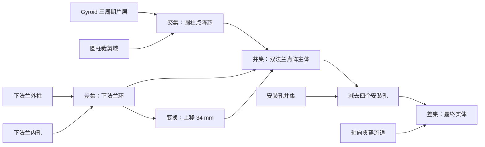

# 复杂模型画廊

本页展示 TPMS Studio 现有建模算子的实际组合。截图来自 Electron 工作台，JSON 包含可继续编辑的节点与参数；模型通过软件生成并导出，未用外部渲染图代替软件预览。

## 打开示例

先按 [libfive 指南](libfive.md) 配置原生库，再在顶部“打开”选择项目 JSON，点击“生成工作流”。打开项目恢复建模关系，不会直接加载生成网格。保留已有工作时，请先保存。

| 项目 | 几何节点 | 数值参数 | 默认网格尺寸 | 可编辑文件 |
| --- | ---: | ---: | ---: | --- |
| Gyroid 双法兰 | 19 | 3 | 0.4 mm | [gyroid-flanged-core.json](../examples/showcase/gyroid-flanged-core.json) |
| 三向开孔球壳 | 11 | 3 | 0.4 mm | [perforated-ring-sphere.json](../examples/showcase/perforated-ring-sphere.json) |
| 参数化八瓣花 | 25 | 4 | 0.3 mm | [eight-petal-flower.json](../examples/parametric-flower/eight-petal-flower.json) |

默认参数是示范设计，未提供保证所有参数组合有效的设计范围。改变尺寸、壁厚或部件位置后，应检查连接、水密性和特征保留情况。

## Gyroid 双法兰结构


模型由三周期片层 Gyroid、圆柱裁剪域、两个环形法兰、四个安装孔及贯穿轴向流道组成。外形约 46 × 46 × 40 mm，法兰半径 23 mm，厚度 6 mm；点阵芯半径 15 mm、高 32 mm。法兰内孔半径 13 mm，使它与点阵芯在边缘区域相交连接。

### 建模关系



图中将多级并集合并显示；JSON 保留每一步实际节点。上法兰引用下法兰环，通过变换复用几何，并非独立重建一套尺寸。

| 参数符号 | 默认值 | 驱动 |
| --- | ---: | --- |
| `wall` | 1.4 mm | Gyroid 片层壁厚 |
| `flange_radius` | 23 mm | 下法兰外柱及其上法兰实例 |
| `bore_radius` | 4 mm | 轴向贯穿流道 |

壁厚与孔隙率会随采样和提取精度变化；组合体没有统一填充参考域，不给出整体孔隙率。这里的轴向开孔也不代表软件已对组合体生成 CFD 网格。

### 检查内部结构


在最终输出启用 Y 方向剖切，将平面居中，勾选“保留法向正侧”，即可在默认等轴测视角观察点阵连接、法兰内壁和中间流道。切面填充来自三角网格与平面求交；剖切前后原始 STL 逐字节一致，完整实体不会因查看操作被裁掉。

## 三向开孔球壳与加强环


半径 19 mm 的外球减去半径 16.5 mm 的内球，得到 2.5 mm 壁厚的空心球壳；加入主半径 18 mm、管半径 2.8 mm 的赤道圆环，再减去半径 9 mm 的 X/Y/Z 贯穿圆柱。

建模链为：**外球 − 内球 → 并集加强环 → 差集三向流道**。圆柱默认轴向为 Z，X 向孔绕 Y 旋转 90°，Y 向孔绕 X 旋转 90°。这展示共享壁厚、方向变换和多级布尔引用的组合。

| 参数符号 | 默认值 | 驱动 |
| --- | ---: | --- |
| `radius` | 19 mm | 外球半径及加强环主半径 `radius - 1` |
| `wall` | 2.5 mm | 内球半径 `radius - wall`，决定球壳壁厚 |
| `bore_radius` | 9 mm | 三条贯穿流道半径 |

三个方向的流道共用开孔半径。孔圆柱默认长 50 mm，增大球半径时需检查它是否仍能贯穿；壁厚须小于外半径，孔过大可能令球壳分离或完全减空。加强环管半径保持 2.8 mm，不随球壳壁厚自动变化。

### 比较输入的位置


打开“全部实体”，隐藏外球、内球及重复中间结果，只保留球壳、加强环和三条流道。半透明与稳定颜色用于判断实体相交和方向，选中孔道在视口中高亮。

布局仍包含五个独立网格，并未把它们自动合成实体。最终差集需生成指定输出；查看显隐和透明度不保存到 JSON，重新打开后可以按需要设置。

## 参数化八瓣花

八片花瓣共用一个椭球公式母体，通过变换每隔 45° 排列；两片叶子复用另一椭球母体，再与花茎和花心逐级并集。最终输出来自 25 个几何节点与 4 个数值参数：花茎高度、花茎半径、花瓣展开半径和花心半径。

这是公式建模、共享参数和母体复用的例子。花朵位于 XZ 平面，沿 Y 方向正对观察；花瓣间距过大或花心过小可能导致部件分离。详细公式、参数与文件见 [八瓣花说明](../examples/parametric-flower/README.md)。

## 公式的符号约定

自定义公式输入的是空间函数 `f(x,y,z)`。在实体模式且等值面偏移为 0 时，保留 `f >= 0`。要定义椭球内部，应使用：

```text
1 - (x/13)**2 - (y/3.2)**2 - (z/6.3)**2
```

正内场的并集、交集和差集分别采用 `max(fA,fB)`、`min(fA,fB)`、`min(fA,-fB)`。`fA/fB` 是说明符号，实际输入须替换为完整受支持的数学表达式。

片层模式使用零等值面两侧的壁厚距离近似。内核将输入转换为 `material_scalar <= 0` 的材料标量；这是内部建模约定，不能将负内距离函数直接作为正内公式使用。参数表达式如 `radius - wall` 引用共享数值，和使用 `x/y/z` 的空间公式分别解析。

## 导出与验证

截图工作流实际打开项目、生成最终实体并导出原始 STL。验证结果见 [几何验收数据](../examples/showcase/geometry-report.json)，记录节点数、提取尺度、面数、外形范围、体积、水密性及连通分量；这些数值属于默认示例和此次原始导出，不能作为任意参数下的性能或误差保证。

| 模型 | 三角面 | 实际外形 / mm | 连通与封闭性 |
| --- | ---: | --- | --- |
| Gyroid 双法兰 | 363,544 | 46 × 46 × 40 | 单一连通体、水密、绕序一致 |
| 三向开孔球壳 | 167,296 | 37.504 × 37.504 × 33.477 | 单一连通体、水密、绕序一致 |
| 八瓣花 | 23,172 | 59.145 × 15.078 × 113.004 | 单一连通体、水密、绕序一致 |

JSON 项目便于修改与版本管理，STL 可通过软件重新生成导出，避免在仓库中重复存放大型生成网格。模型尚未进行结构承载、流体求解、制造或打印验收。网格尺寸不是严格最大误差或面数保证；实体组合暂不支持 CFD、STEP 或精确 B-Rep。

重建项目和截图的方法见 [工程验证与截图](electron.md#验证与截图)。
