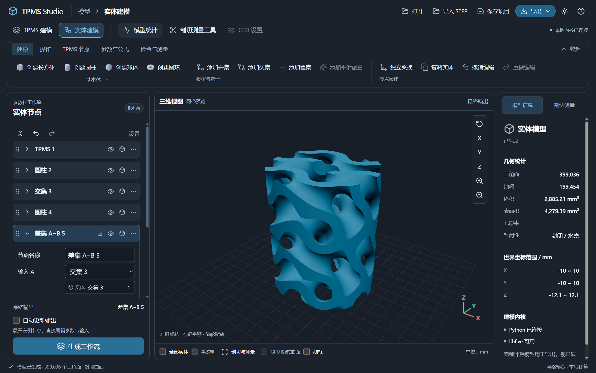

# Magpie 圆角界面与深灰蓝配色

希望在其他 App 中复现这套风格，可以阅读 [圆角 App 界面设计指南](Magpie青绿色App界面设计指南.md)，并使用 [深灰蓝配色](blue-gray-palette.md) 的当前色值。原指南中的青绿版本保留为历史配色参考。

TPMS Studio 桌面保持 Electron + React + Three.js，Python 进程继续负责建模与网格计算。保留 Magpie 的圆角卡片和轻量顶部栏，按新参考图使用深灰底、浅色文字、蓝色强调和蓝色模型；导航按桌面建模习惯放在顶部。

顶部文件栏集中打开、STEP 导入、保存、导出与主题切换；下一行切换 TPMS、实体建模及导入模型工作区，并提供模型统计、剖切测量和 CFD 设置。界面没有左侧分组导航。功能工具栏按工作区提供命令，可收起以扩大模型视图。

左侧参数按曲面、尺寸、周期及结构分组，常用参数横向排列，XYZ 保持并排。输入数值使用 16px 字体，生成按钮固定在底部；长内容单独滚动。中央保留 GPU 隐式预览、网格查看、轴向观察及 XYZ 方向标，右侧提供模型信息和剖切测量。

实体与参数卡片沿用现有编辑、拖动排序、引用、上下游展开及撤销重做。选中卡片使用蓝灰色表面，输入框和菜单统一边框与圆角；生成按钮使用蓝色。

新用户及本次配色升级首次进入深色。右上角月亮/太阳切换主题，后续选择保存于本地。暗色采用深灰表面与蓝色操作；亮色采用白色和浅蓝灰表面，主按钮文字均为白色。

## 运行与验证

双击项目根目录的 `启动Electron.cmd` 或 `run_tpms.bat`。启动器按需构建界面，无需打包可执行文件。

界面验证使用实际 Electron 窗口，覆盖明暗主题、1120 × 760 窗口、功能工具栏和键盘导航、节点编辑与真实生成、保存恢复、剖切测量及模型导出。已有建模和 IPC 单元测试继续执行。
