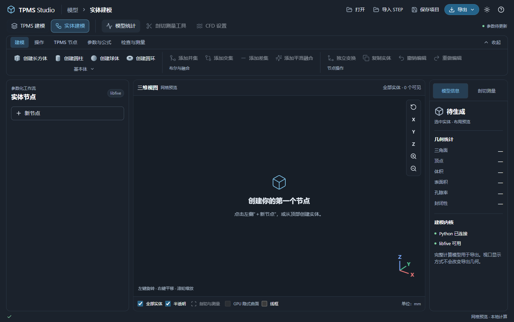
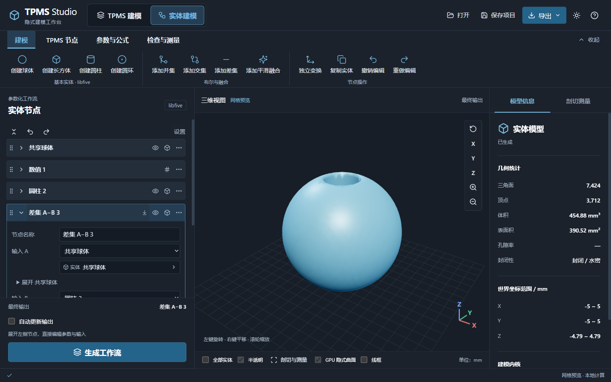

# 节点式参数化建模

当前界面包含简洁可拖动卡片、多实体布局与最终输出查看。项目时间与逐次变更见 [开发记录](../DEVELOPMENT_LOG.md)。

当前界面采用简洁的纵向 Notebook 卡片。点击顶部 **实体建模**，空项目左侧只显示“＋新节点”，中央与统计为空。创建后在卡片内部编辑；实体和参数使用同一列表。计算仍沿上游引用构建 DAG，由 libfive 生成表面网格。



## 创建与编辑

1. 点击“＋新节点”，搜索基本体、TPMS、布尔、变换或数值/公式/向量参数；也可通过顶部工具栏创建。
2. 新节点自动展开，直接编辑名称、尺寸与参数。位置和旋转折叠显示；TPMS 节点可编辑曲面、周期、壁厚、孔隙率、梯度和自定义公式。
3. 布尔卡片选择输入 A/B，差集始终为 A 减 B。变换卡片引用一个输入实体，平移旋转不改写上游。
4. 多实体布局下标题眼睛控制显示/隐藏；在菜单选择“单独预览”查看中间实体；右键标题或点击“⋯”执行复制、删除、设为输出和上移/下移。
5. 左侧“设置”选择最终输出与网格尺寸。创建实体后，底部显示最终输出、自动更新和“生成工作流”；生成成功后从顶部导出 STL、OBJ 或 PLY。


名称点击选中并展开，左侧三角独立折叠；多个卡片可同时展开。“收起所有节点”恢复标题概览。卡片取消固定分组、序号、彩色类型标签和重复状态摘要；错误仍显示在对应节点，计算进度显示在状态栏。

布尔输入的引用标签可点击定位来源，也可使用“展开上游”在当前卡片中编辑。嵌套编辑与顶层卡片都按原节点 ID 更新同一份数据，多个下游不会获得独立副本。嵌套展开最多三层，更深层可点击引用定位；循环输入仍被拒绝。折叠时不加载嵌套表单。

输出设置还包含参数求值、旧共享常量与示例工作流。空项目可在创建入口展开“从示例开始”；加载替换当前工作流，请先保存。设置、展开、选择、菜单和定位不修改几何或进入撤销历史；展开状态不保存到 JSON。

## 多实体布局与相对位置

创建实体后默认开启“全部实体”，各节点独立显示，参数节点没有几何外形。编辑尺寸、位置与旋转后 450 ms 防抖更新布局；重排卡片不重新生成布局。可以直接比较球体与盒体的位置和相交关系，不需要先生成并集。


不同实体分配稳定颜色，选中实体高亮；半透明配合边缘线帮助看清遮挡。模型单击、视口标签或节点名称均可选中；拖动旋转不误选。移动或放大实体超出当前包围范围时自动适配视野并保留相机方向。“半透明”可关闭，卡片眼睛控制单个实体显示/隐藏。

布尔与变换节点也可显示在同一布局中；未完成、循环或计算失败的节点给出原因，其余有效节点继续显示。每个实体仍是独立网格，布局重叠不代表已做布尔。右侧统计属于当前选中实体，不能直接把相交实体体积相加。

“生成工作流”显示指定最终输出；重新开启“全部实体”对比源实体和结果。布局渲染使用独立计算进程及有界缓存，不锁定参数编辑，也不写入最终输出快照。布局精度可为基本实体使用较粗自适应尺度，项目的最终网格尺寸保持原值；最终输出与正式导出仍须生成。

在布局模式使用“⋯ → 单独预览”，或生成最终输出后，可进行剖切测量。布局不同时计算各重叠实体的材料截面。透明度、显隐和布局开关属于查看状态，暂不保存至 JSON。

## 复杂项目的组织方式

19 节点的 Gyroid 双法兰项目保留独立的点阵、裁剪、法兰、孔与布尔步骤。需要修改壁厚时，展开“点阵壁厚 / mm”参数；需要查看相交关系时，开启“全部实体”，隐藏原始裁剪域和重复结果；需要检查最终材料时，生成指定输出并进行剖切。

| 任务 | 推荐查看方式 |
| --- | --- |
| 判断输入 A/B 的位置与方向 | 全部实体，隐藏无关节点，半透明显示 |
| 检查一个中间运算 | 节点菜单“单独预览” |
| 检查完整组合或导出 | 生成工作流，最终输出视图 |
| 检查贯穿孔与点阵连接 | 最终输出的剖切与测量 |
| 整理工作流 | 收起卡片、命名、拖动排序与引用定位 |

参数放在列表前部便于设计修改，实体按建模关系命名。排序影响显示位置，实际计算按上游引用执行，因此上下移动卡片不会改变运算顺序或几何。

可编辑复杂项目、默认参数与网格回读结果见 [模型画廊](model-gallery.md)。

## 排序与拖动引用

拖动标题或左侧手柄到另一个卡片标题，上半部插入前面，下半部插入后面；实体与参数允许交错排序。长列表靠近左栏边缘自动滚动。右键/“⋯”菜单中的上移和下移、聚焦手柄后按 ↑ / ↓ 提供替代操作。

排序只修改显示顺序，保留选中、参数结果、模型、中间预览和计算状态，不触发自动更新；随项目保存并支持撤销重做。旧项目没有显示顺序字段时，按原参数和实体顺序显示。

拖动标题右侧类型图标或已有引用标签到目标输入，兼容输入高亮并显示连接提示。图标的悬停提示与可访问名称说明实体、数值或向量类型。输入下拉和 fx 编辑仍可使用。

| 来源 | 接收输入 | 建立连接后的行为 |
| --- | --- | --- |
| 实体 | 布尔 A/B、变换输入、设置中的最终输出 | 按节点 ID 更换引用 |
| 数值/公式 | 尺寸、位置/旋转分量、TPMS 数值参数、融合宽度 | 用参数符号替换该字段的表达式 |
| 数值/公式 | 参数公式、向量 XYZ 分量 | 替换整个公式或一个分量 |
| 向量 | 位置/旋转向量引用 | 绑定整向量，清除相应分量 fx，禁用手动分量 |

错误类型、自身/下游循环、重复 A/B、参数循环、符号冲突和含 TPMS 的平滑融合均拒绝，拒绝不改写项目。整向量绑定后先解除引用，才能连接单个分量。计算期间暂停编辑和拖动；外部文件、文本和其他项目的引用不接受。连接修改参与依赖失效与历史，需重新生成。



## 共享参数与表达式

“＋新节点”支持三种独立类型，最多 32 个参数；展开参数节点编辑定义。简单模型无需先创建参数，直接填写尺寸即可：

| 类型 | 输入 | 输出/引用方式 |
| --- | --- | --- |
| 数值 | 有限数字，例如 4 | 数值字段下拉框或 fx 引用 `radius` |
| 公式 | 算术表达式，例如 `radius * 2` | 标量符号，例如 `diameter`；可引用其他标量及向量分量 |
| 向量 | XYZ 三个数值或表达式，例如 `diameter + 12, 0, radius` | “位置向量引用”/“旋转向量引用”选择该节点，或在 fx 引用 `offset_x / offset_y / offset_z` |

每个参数块有显示名称和英文引用符号；公式按实际依赖解析，不要求列表顺序。不能将整个向量符号当作一个数字，不能将标量接到向量输入，重复符号、未知变量和参数循环均拒绝。“计算参数值”可在没有几何时检查标量/向量结果。选中向量后手动 XYZ 禁用并清除对应分量表达式；取消引用恢复此前保存的手动数值。

参数节点中的“引用此参数”显示使用者，点击跳转到对应参数或实体节点。收起状态保留名称与类型图标，展开后查看定义、符号和结果。


在“设置”中展开“共享常量”仍可添加 `wall`、`radius`、`height` 等旧共享数值。节点数值框旁的 **fx** 切换为表达式输入，可以填写：

```text
半径：radius
高度：height * 2
TPMS 壁厚：wall
X 位置：radius * 3
融合宽度：max(wall * 2, 1)
```

允许 `+ - * / **`、括号、`pi` 和 `abs/min/max/sqrt`。不执行 Python 代码；属性访问、索引、未知变量、除零及非实数结果均拒绝。参数名须为英文标识符，最长 32 字符，最多 32 个参数；`pi/abs/min/max/sqrt` 是保留名称。表达式最长 256 字符，指数绝对值不超过 8，中间结果绝对值不超过 1,000,000；最终数值仍受具体建模参数范围限制。

单位沿用输入项：尺寸/位置/壁厚为 mm，旋转为度，孔隙率为 0–1，周期数和采样数必须得到整数。数值表达式与 TPMS 的 `f(x,y,z)` 曲面公式是两个输入：前者引用共享参数，后者沿用已有空间函数语法。

修改共享参数后，引用它的实体和下游运算在下一次生成中使用新值。切回普通数值时恢复该字段此前保存的数值。参数被表达式引用时禁止删除。TPMS 节点保存自己的参数快照，“使用当前 TPMS 参数”会用普通 TPMS 工作区的设置替换它，并清除该节点的 TPMS 参数绑定。

## 生成、历史与项目

修改参数后受影响节点等待更新，视口保留同一项目上次生成的最终结果，导出等待重新生成。计算解析参数并沿输出依赖编译数学表达式树，复用未改变的数学场；状态栏显示进度。未参与当前输出的节点不会主动提取网格。

在最终输出视图点击几何卡片标题眼睛，或使用“⋯ → 单独预览”可单独查看球、孔、布尔或变换后的实体，并在右侧“模型信息”显示当前预览统计。“返回最终输出”恢复已生成最终模型。预览不改变输出节点、不清除参数待更新状态、不替换后端导出快照；最终导出仍使用指定输出。编辑参数会退出中间预览，避免把旧预览误认为新结果。选择节点不会切走右侧已打开的剖切测量工具。


“自动更新输出”默认关闭。开启后停止编辑 900 ms 自动生成；输入错误或取消后不会自动反复重试相同设置，修正输入后可继续自动更新，也可点击生成重试。计算仍在独立 Python 进程中，期间参数控件禁用，视口可旋转，支持取消。

缓存范围：同一 Python 计算进程内，已解析参数与上游签名决定数学场复用；改名称不重建几何，改网格尺寸会失效。近期完整网格使用 LRU，最多 8 个且顶点/面数组总计不超过 96 MiB；数学场达到 192 条或原生指针超过 250,000 时在下次未命中网格的请求前重置。预算不包含 trimesh 属性缓存与提取网格的峰值内存。取消、重启进程清空缓存，缓存不写入项目 JSON。变化后的输出仍提取完整网格，尚未实现局部网格补丁更新。

工具栏提供节点工作流的撤销/重做（最多 50 步）；非文本编辑状态下也可用 `Ctrl+Z`、`Ctrl+Shift+Z` 或 `Ctrl+Y`。文本框内保留正常的文本撤销。复制保留参数与上游引用，形成可独立调整的新节点。

“保存项目”记录几何节点、数值/公式/向量块、标量表达式、向量引用、共享常量、输出和精度；参数块也参与 50 步撤销重做。只有参数、没有几何的工作区可以保存。“打开”恢复节点工作区，重新生成后得到网格。撤销历史、自动更新开关、属性展开状态和缓存不保存。版本仍为 1，通过可选 `value_nodes`、`vector_inputs` 与显示顺序 `notebook_order` 字段兼容旧 JSON；原实体组合裸 JSON 与旧 Electron 实体模式项目自动进入统一节点工作区，保留实体、参数、引用、输出与精度；保存后使用节点模式。普通 TPMS 项目仍进入 TPMS 工作区。

空工作区可在“＋新节点 → 从示例开始”加载示例；有对象时，在“设置”展开“示例工作流”选择球体贯穿孔、双球融合或圆柱 TPMS 减流道。示例替换当前对象，先保存需要保留的项目。


## 当前范围

- 支持球、盒、圆柱、圆环、五种 TPMS、自定义公式、四种布尔/融合和独立平移旋转节点，最多 64 个实体节点。
- 这是 Notebook 式节点树与拖动引用工作流；自由连线画布、任意自定义分组和跨文件子工作流尚未提供。
- 参数块目前支持标量与向量；没有 nTop 的空间场、列表、网格类型系统或单位自动换算。参数公式采用有限算术语法，不等于 TPMS 空间函数编辑器。
- 网格导入转隐式、Voronoi 点阵、体网格节点及 STEP/B-Rep 输出尚未加入。节点工作流不等于已经支持截图中 nTop 的所有功能块。
- 组合输出暂不支持 CFD/COMSOL，管状卷绕 TPMS 不支持进入实体图；平滑融合只支持基本体及其组合。
- 空间中的细孔和薄壁仍受 libfive 网格尺寸影响，需要精度收敛检查。错误保留上次模型；取消计算清空后端结果，需要重新生成。
- 使用 Electron 工作台编辑含表达式与变换节点的项目；Qt 兼容版本没有新增的节点编辑界面。

实现：`desktop/src/NodeWorkflow.jsx`、`ValueBlocks.jsx`、`WorkflowDrag.jsx`、`workflow_drag.mjs`、`node_graph.mjs`、`parametric.py`、`workflow_values.py`、`workflow_engine.py`、`solid_model.py` 和 `electron_backend.py`。

```powershell
python -m pytest -q
cd desktop
npm run build
npm test
npm run verify-notebook-cards
npm run verify-multi-entity
npm run verify-nodes
npm run verify-node-optimization
npm run verify-workflow-layout
npm run verify-workflow-navigation
npm run verify-workflow-drag
```

验证包含真实共享参数联动后的体积/坐标、类型与参数循环防护、旧项目兼容、数学场依赖复用、中间预览/最终导出隔离、自动更新错误恢复、独立节点展开、键盘折叠、类型化引用定位、保存恢复、撤销重做、STL 导出、1120×760 布局及节点选择期间的剖切工具保留。

排序与连接验收使用实际鼠标拖动，覆盖实体/参数排序、边缘滚动、按钮/键盘替代、保存恢复、连接撤销重做、标量/向量/实体/最终输出/参数公式连接、错误拒绝与中间预览保留。排序前后及重新打开后的 STL 逐字节一致；连接后实际生成并核对坐标变化。
