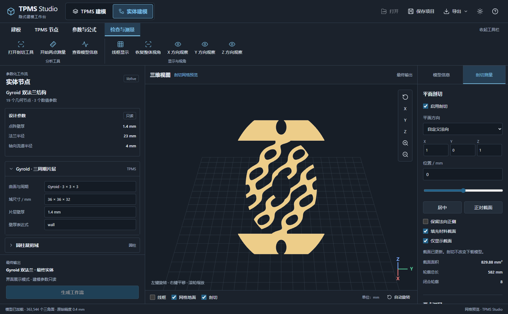

# 在线模型工作台

[打开在线预览](https://starlre.github.io/TPMS-Studio/)

在线工作台展示软件实际生成的 **Gyroid 双法兰结构**。其布局、暗亮主题、模型配色、工具栏和检查器与桌面软件保持一致。左侧展示真实的 19 个几何节点、3 个数值参数及上游输入；在线参数只读，下载 JSON 后可在桌面软件中继续编辑。

## 桌面 App 界面展示

顶部保留“TPMS 建模”和“实体建模”工作区切换，使用桌面 App 的字号、主题、图标、选项卡与分组工具栏。默认进入实体建模，展示完整双法兰工作流。

| 工作区 | 顶部选项卡 | 展示内容 |
| --- | --- | --- |
| 实体建模 | 建模、TPMS 节点、参数与公式、检查与测量 | 球体/长方体/圆柱/圆环、布尔与融合、节点操作、TPMS/公式与设计参数工具 |
| TPMS 建模 | TPMS、检查与测量、仿真与网格 | 曲面/尺寸/结构参数、检查工具、CFD 与网格工具 |

切换工作区只切换界面，始终保留同一双法兰模型。TPMS 参数面板展示项目中真实点阵节点的周期、尺寸和壁厚；创建、编辑、参数求值、重新生成和 CFD 工具保持禁用，并提供桌面 App 使用提示。网页用于界面展示与模型检查，不执行建模计算。

文件区保留“打开、保存项目、导出、主题、操作说明”。“保存项目”下载可编辑 JSON，“导出”下拉提供原始 STL 下载与导出精度选项展示，精度重算及体网格导出需要桌面 App。


## 查看与下载

- 拖动旋转、右键平移、滚轮缩放；方向键也可平移视角。
- 使用视口右侧的 XYZ 按钮切换轴向视角，放大、缩小或重置视角。
- 顶部切换全局暗亮主题，底部切换线框、地面网格、剖切与自动旋转。
- “导出 → 下载 STL”取得原始完整实体；“保存项目”取得可在桌面软件中打开的节点项目。
- 手机使用“建模步骤”和“模型信息”打开面板，关闭面板后恢复完整三维视口。

| 模型属性 | 默认示例 |
| --- | --- |
| 结构 | 三周期 Gyroid 片层点阵芯、上下环形法兰、四个安装孔、轴向流道 |
| 外形尺寸 | 46 × 46 × 40 mm |
| 片层壁厚 / 轴向孔径 | 1.4 mm / 8 mm |
| 生成网格尺寸 | 0.4 mm |
| 原始三角面 | 363,544 |
| 文件大小 | 18,177,284 字节，约 17.34 MiB |
| 回读结果 | 单一连通、封闭水密、绕序一致、正体积 |

模型信息来自实际 STL 回读。剖切和显示调整不会改变下载的原始网格；当前网页没有在线计算内核，不能重新生成节点或执行布尔运算。

## 剖切与测量

进入“检查与测量”选项卡并点击“打开剖切工具”。选择 X/Y/Z 平面，或输入自定义法向量，再使用位置滑块或数字输入移动切面。“居中”和“正对截面”便于观察内部结构，可反向保留、填充材料区域或仅显示截面。



截面与测量复用桌面软件的几何算法，在浏览器后台计算。材料填充保留孔洞，提供截面面积、轮廓总长和闭合轮廓数；开放或分叉轮廓会提示无法可靠计算面积。

“两点测量”在可见表面上选择 A、B 两点，显示世界坐标和直线距离。拖动旋转不会触发选点，Esc 结束选点，修改切面会清除旧测量。“恢复完整模型并清除测量”返回完整实体。

## 构建与验证

网页源码在 `web/`，静态发布内容在 `docs/`。三维依赖与后台处理模块打包到站点，不依赖外部 CDN。模型按文件摘要标记版本并在加载时校验；STL 解析、显示法线、剖切及拾取在后台工作线程完成，静止时视口停止持续绘制。

```sh
npm --prefix desktop ci
npm --prefix desktop run build:web
python scripts/verify_web_model.py
npm --prefix desktop run verify-web
```

构建保留文档、图片、模型和项目文件，只替换页面及网页构建产物。GitHub Actions 在发布分支的 `docs/` 更新后部署 GitHub Pages。验证覆盖部署子目录、模型哈希、下载一致性、节点与参数、主题与视角、剖切测量、手机布局、加载失败与重试。
