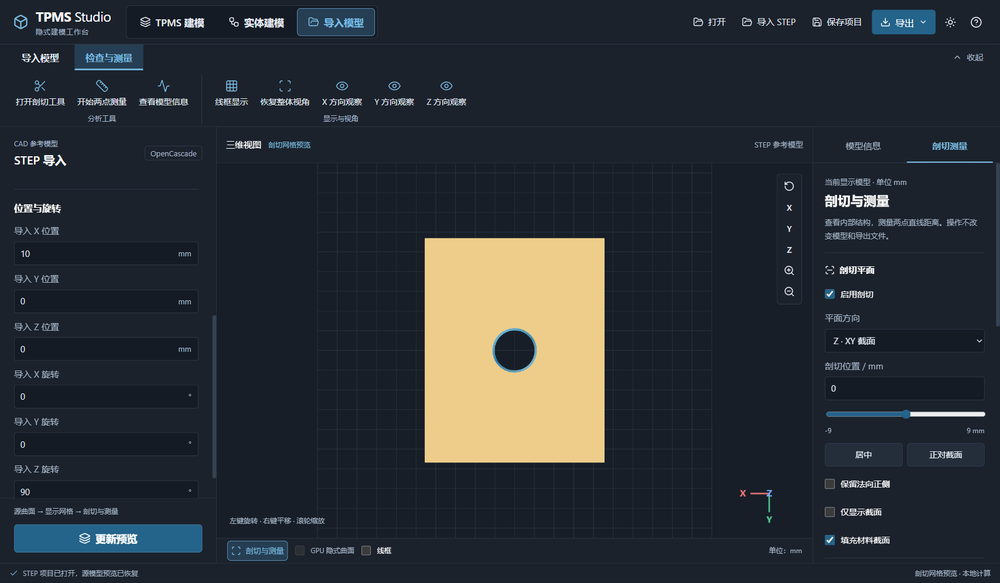

# STEP 参考模型导入

STEP / STP 是 CAD 曲面与拓扑交换格式。本功能通过 OpenCascade 读取文件，将原曲面离散为预览网格；保留源曲面的统计信息，显示、测量与网格导出采用成功更新的网格快照。

## 安装与入口

在项目环境安装可选依赖，再重启桌面软件：

```sh
python -m pip install -r requirements-step.txt
```

顶部点击“导入 STEP”选择文件。成功后出现“导入模型”工作区，提供源模型、显示精度和位置旋转编辑。无效文件或取消选择不会替换当前模型。仅支持含曲面的 STEP，纯曲线/点文件尚不支持。

可用 [开孔盒体 STEP 示例](../examples/import/holed-block.step) 验证导入：30 × 24 × 18 mm 长方体，半径 3 mm 的轴向贯穿孔。


## 精度、坐标与统计

- 曲面偏差：0.001–10 mm，默认 0.1 mm；越小通常产生更多三角面。
- 角度偏差：1–60°，默认 20°；控制曲面转角离散。
- 平移：XYZ，单位 mm；旋转：XYZ，单位度，先绕 X、Y、Z 旋转，再平移。
- 修改后点击“更新预览”；未更新时显示上次快照，网格导出禁用。

源文件单位转换为 mm。CAD 实体数、曲面数、表面积与实体体积来自源曲面；三角面、顶点、网格表面积和水密状态来自显示网格，二者精度不同。开放曲面没有可靠网格体积，显示为“—”。多实体按照文件中的位置一起显示，暂不保留名称、颜色和装配层级；实体体积为分量总和，重叠部分没有自动求并。

文件上限为 128 MiB，显示网格上限为 200 万三角面；大型或高精度模型需要更多计算时间与内存，可取消后台导入。面数检查在曲面离散后执行，不保证原生离散阶段峰值内存受该上限约束。

## 剖切、测量与导出

切换“检查与测量”，可使用轴向/任意法向剖切、截面材料填充、截面面积/轮廓和两点距离。开放曲面的截面可能没有闭合轮廓，无法可靠填充或算面积时会提示。



测量基于显示网格。导出支持 STL / OBJ / PLY 和已有面数简化选项，使用上次成功更新的网格；不输出原 CAD 曲面的 STEP，也不承诺简化后保持 CAD 精度。

## 保存与恢复

“保存项目”记录源文件引用、SHA-256 摘要、精度与变换；不嵌入 STEP 或显示网格。重新打开会核对并读取源文件，自动恢复预览。源文件缺失或内容改变时明确拒绝恢复并保留当前模型，重新通过“导入 STEP”选择即可建立新引用。共享项目时需要同时保留源文件，并在接收环境重新导入建立引用。

导入工作区保存独立参考项目，不保存其他工作区的节点图。切换到 TPMS 或实体建模后，原 STEP 引用留在当前会话，可切回并更新预览；后台取消或重启后也需更新。

## 当前范围

这是参考导入：支持查看、坐标变换、检查与网格输出。STEP 暂不作为隐式实体节点，不参与布尔、TPMS 区域填充、抽壳或 CFD 网格；任意 CAD 转隐式场与精度控制是后续工作。

实现：`cad_import.py`、`electron_backend.py`、Electron 文件对话框与导入工作区。验证：`test_cad_import.py`、`npm test` 和 `npm run verify-step-import`，覆盖实体、开放曲面、多实体、内腔方向、单位、精度、变换、保存恢复、导出及失败保护。
