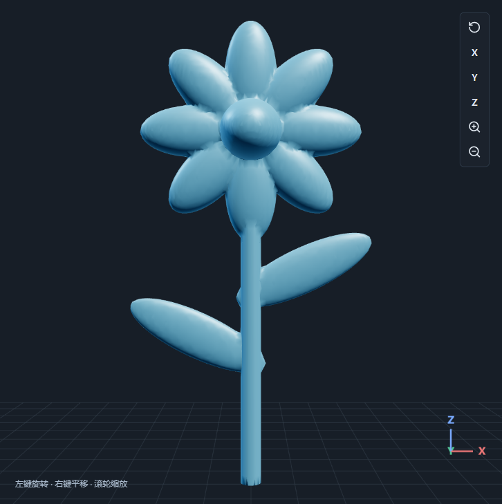

# 八瓣花建模示例

通过 TPMS Studio 实际节点界面建立：八片花瓣、花心、花茎及两片叶子，组合为一个连续实体。示例使用现有公式、变换与并集节点，没有新增软件功能。



## 打开与编辑

在软件中点击“打开”，选择 `eight-petal-flower.json`，再点击“生成工作流”。项目包含 25 个几何节点及 4 个数值参数；最终输出为“八瓣花 · 最终实体”。

| 参数 | 默认值 / mm | 控制内容 |
| --- | ---: | --- |
| 花茎高度 `stem_height` | 80 | 花茎长度、花头高度和叶片高度 |
| 花茎半径 `stem_radius` | 2.5 | 花茎粗细 |
| 花瓣展开半径 `petal_distance` | 14 | 八片花瓣的径向中心位置 |
| 花心半径 `center_radius` | 7.5 | 花心球体尺寸 |

花瓣和叶片共用各自的椭球母体，通过变换节点摆放。花瓣每隔 45° 排列在 XZ 平面，正面沿 Y 方向观察。自定义公式选择“实体结构”、等值面偏移为 0；当前实体模式保留 `f >= 0`，因此椭球内部采用：

```text
花瓣：1 - (x / 13)**2 - (y / 3.2)**2 - (z / 6.3)**2
叶片：1 - (x / 18)**2 - (y / 1.7)**2 - (z / 5.5)**2
```

修改母体公式后，引用它的花瓣或叶片共同改变；修改位置参数后重新生成。参数未设置专用设计范围，增大花瓣间距或缩小花心可能使部件分离，需保持各部分相交并检查生成结果。

## 文件与验证

- `eight-petal-flower.json`：可继续编辑的节点、参数与引用关系。
- `eight-petal-flower.stl`：原始精度表面网格，单位按 mm 使用。
- `flower-preview.png`、`flower-workbench.png`：实际软件截图。

默认网格尺寸 0.3 mm，生成 23,172 个三角面，模型约 59.145 × 15.078 × 113.004 mm，STL 约 1.159 MB。实际导出回读验证为单一连通体、水密且面绕序一致；这只是几何示例，未进行打印、承载或制造验收。
